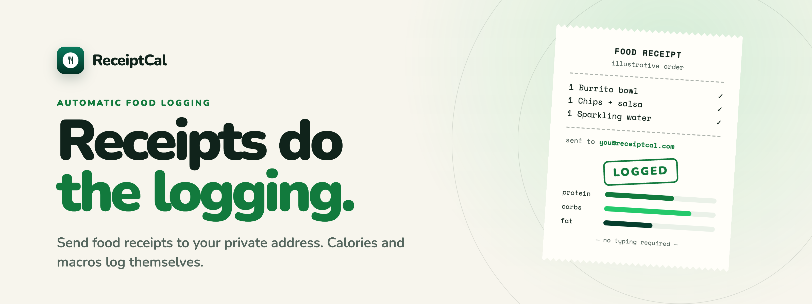
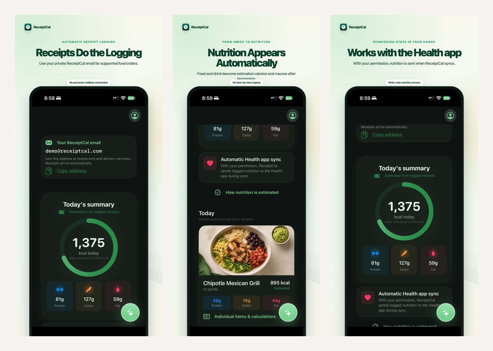
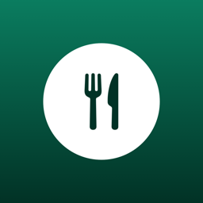

  <a href="https://receiptcal.com">
    <picture>
      <source media="(prefers-color-scheme: dark)" srcset="assets/banner-dark.png">
      
    </picture>
  </a>

  <strong>Automatic food logging from your receipts.</strong> 
  Order food the way you already do. ReceiptCal turns the receipt into estimated calories and macros, with no meal-by-meal typing.

  <a href="https://receiptcal.com"><strong>Website</strong></a> ·
  <a href="https://apps.apple.com/us/app/receiptcal/id6793719739"><strong>App Store</strong></a> ·
  <a href="https://receiptcal.com/how-it-works/"><strong>How it works</strong></a> ·
  <a href="https://receiptcal.com/developers/"><strong>Developers</strong></a>

  
  
  

  

### Why ReceiptCal

Food tracking usually fails on the typing. **ReceiptCal skips it.** You get a private `@receiptcal.com` address. Use it when you order from restaurants and delivery services, or forward the food receipts you choose. Each receipt becomes a logged meal with estimated calories and macros, and, with your permission, the nutrition syncs to the Health app on iPhone or Health Connect on Android.

<table>
  <tr>
    <td width="33%" valign="top">
      <h4>🧾 Receipts do the logging</h4>
      Supported food receipts become meals in your log. No searching for each item.
    </td>
    <td width="33%" valign="top">
      <h4>🔒 Your inbox stays yours</h4>
      ReceiptCal never connects to your personal mailbox. It only sees email sent to your receipt address.
    </td>
    <td width="33%" valign="top">
      <h4>📚 Sources, not guesswork</h4>
      Matched items use USDA data. Anything estimated is labelled as an estimate, never as verified.
    </td>
  </tr>
</table>

### Open source and developers

| | Project | What it is |
| --- | --- | --- |
| 🤖 | [**receiptcal-plugin**](https://github.com/ReceiptCal/receiptcal-plugin) | MCP plugin that brings your ReceiptCal food log into Claude Code, Codex and other AI assistants, with OAuth sign-in and approve-first changes. MIT. |
| 🥗 | [**open-nutrition-transaction**](https://github.com/mihirkavi/open-nutrition-transaction) | An open standard for moving the nutrition of food you buy, with your permission, from stores and restaurants to the apps you choose. JSON Schema, OpenAPI, validator. |
| 🔌 | [**Hosted MCP server**](https://receiptcal.com/developers/) | `https://mcp.receiptcal.com/mcp`, plus [`openapi.json`](https://receiptcal.com/openapi.json) and [`llms-full.txt`](https://receiptcal.com/llms-full.txt). |

The app and backend source are private.

Nutrition values are estimates for everyday tracking, not medical advice.

   
   
  <strong>ReceiptCal</strong> · Receipts do the logging.

